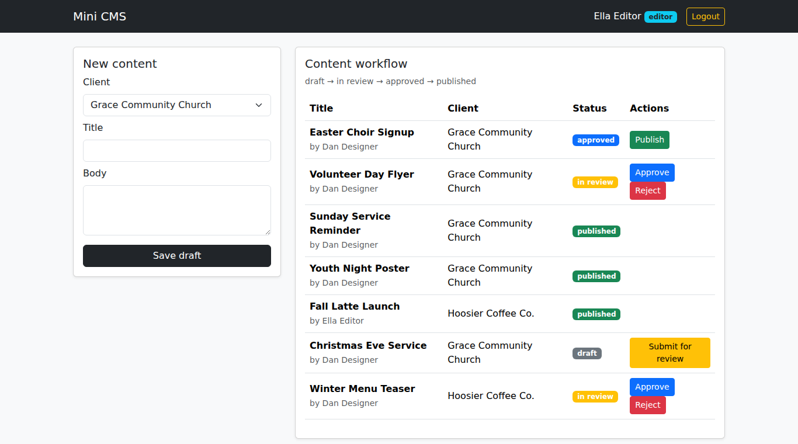
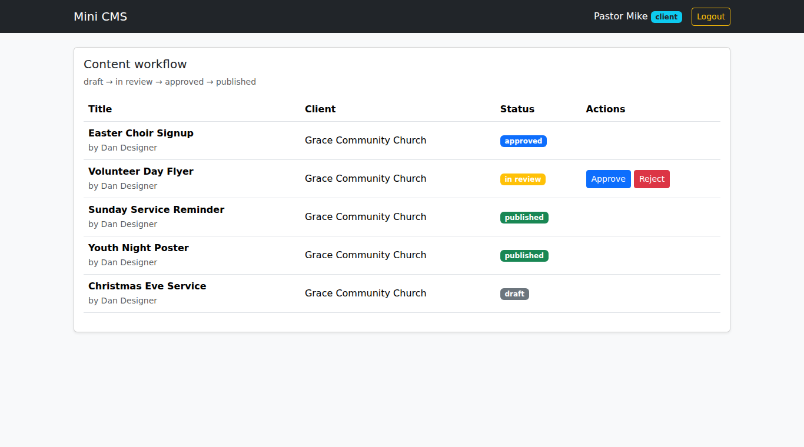
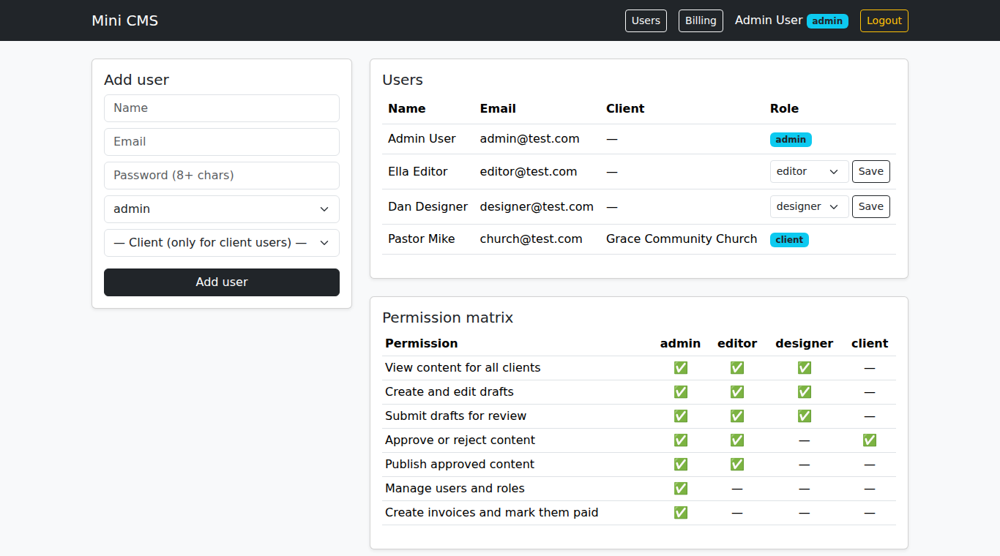
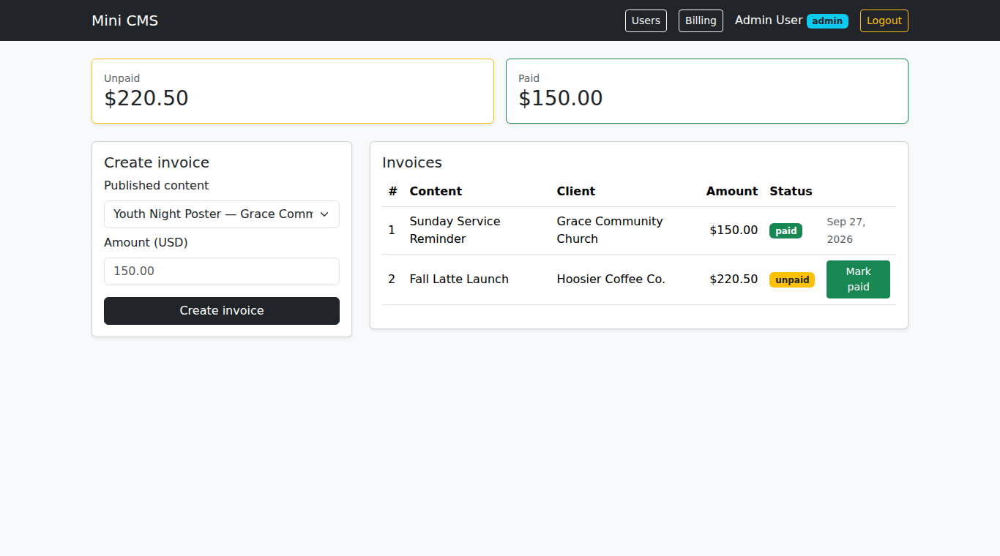
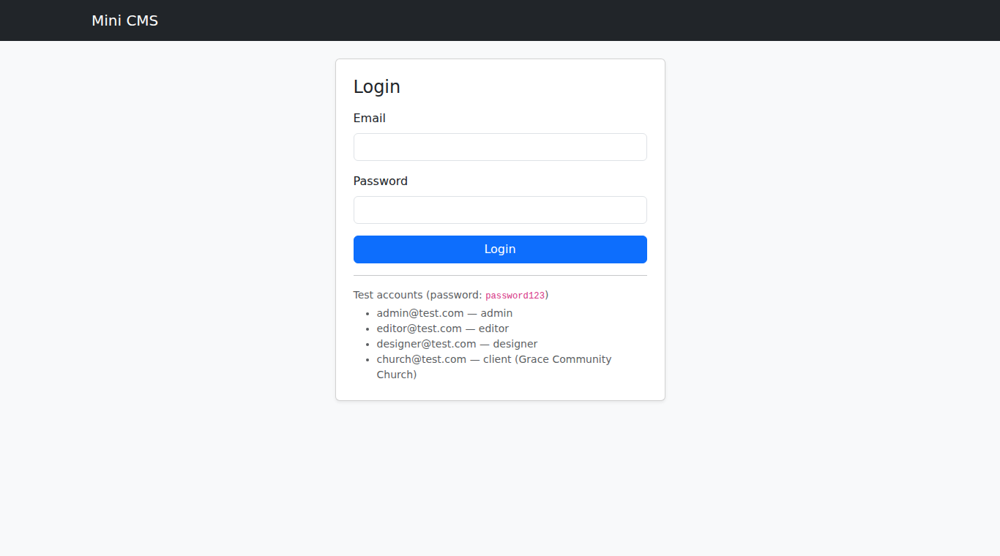

# Mini CMS Workflow

A multi-client content management system in **plain PHP, MySQL and Bootstrap 5**. It has role-based permissions, a content approval workflow, and client billing.

It's built the way many small agencies need it: staff create content for several clients, clients approve their own content, editors publish it, and admins invoice for the finished work.



## Features

- **Login and roles:** admin, editor, designer and client, with hashed passwords and secure sessions
- **Database-driven permissions:** roles and permissions are stored in tables, so a new permission is an `INSERT`, not a code change
- **Approval workflow:** `draft → in review → approved → published`, and reject sends an item back to draft
- **Client isolation:** client users only ever see and approve their own organization's content
- **User management:** admins add users, change roles and view a live permission matrix
- **Billing:** invoice published content once, mark invoices paid, and see unpaid and paid totals
- **Activity log:** every workflow action is recorded in `content_log`

## Workflow

| Action | Permission needed | From | To |
|---|---|---|---|
| Submit | `content.submit` | draft | in review |
| Approve | `content.approve` | in review | approved |
| Reject | `content.approve` | in review | draft |
| Publish | `content.publish` | approved | published |

All transitions are defined in one table in `action.php`. The server re-checks the permission, the current status and client access on **every** request. Updates use `WHERE status = ?`, so double clicks and simultaneous edits can't skip a step.

## Screenshots

| Client view (own content only) | Users and permission matrix |
|---|---|
|  |  |

| Billing | Login |
|---|---|
|  |  |

## Tech stack

- PHP 8 (PDO, no framework)
- MySQL / MariaDB
- Bootstrap 5.3
- Runs on XAMPP or any PHP + MySQL host

## Security

- `password_hash()` / `password_verify()`, and `session_regenerate_id()` at login
- PDO prepared statements for every query (SQL injection)
- `htmlspecialchars()` on all output (XSS)
- CSRF token on every POST form, checked with `hash_equals()`
- Server-side permission checks on every action (hidden buttons are not the only protection)
- Money stored as `DECIMAL(10,2)`; a `UNIQUE` constraint prevents double billing

## Run it locally (XAMPP)

1. Copy this folder to `C:\xampp\htdocs\mini-cms-workflow\`
2. Start **Apache** and **MySQL** in the XAMPP Control Panel
3. Open `http://localhost/phpmyadmin`, go to **Import**, choose `schema.sql` and click **Import**
4. Open `http://localhost/mini-cms-workflow/login.php`

The database settings are at the top of `app.php` (XAMPP defaults: user `root`, no password).

### Test accounts

All passwords are `password123`.

| Email | Role | Can do |
|---|---|---|
| admin@test.com | admin | Everything, plus Users and Billing |
| editor@test.com | editor | Create, submit, approve, publish |
| designer@test.com | designer | Create drafts and submit for review |
| church@test.com | client | See and approve Grace Community Church content only |

## Project structure

```
app.php        Shared setup: DB connection, sessions, CSRF, can()/authorize(), layout
login.php      Login form
logout.php     Ends the session
index.php      Dashboard: new content form and workflow table
action.php     All workflow changes (create, submit, approve, reject, publish)
users.php      Admin: add users, change roles, permission matrix
billing.php    Admin: create invoices and mark them paid
schema.sql     Database tables and seed data
```

## Database

`roles` · `permissions` · `role_permissions` · `clients` · `users` · `content_items` · `content_log` · `invoices`

## Author

**Mayjhon V. Gabunada**, Full Stack Web Developer and Data Analyst, Cebu, Philippines
[Portfolio](https://mgabunad.github.io/portfolio/) · [GitHub](https://github.com/mgabunad) · [LinkedIn](https://www.linkedin.com/in/mayjhon-gabunada-316618431/)
